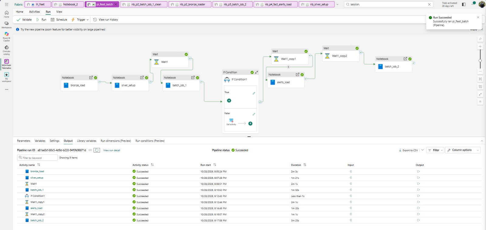

<div align="center">

# Fleet Telematics Lakehouse

**A streaming and batch data platform for fleet telemetry on Microsoft Fabric**


SIC 8 / 2026 · Big Data Engineering · Project 3

</div>

---

## Table of Contents

1. [Overview](#1-overview)
2. [Architecture](#2-architecture)
3. [Key Features](#3-key-features)
4. [Technology Stack](#4-technology-stack)
5. [Repository Structure](#5-repository-structure)
6. [Data Generator](#6-data-generator)
7. [Data Layers](#7-data-layers)
8. [Orchestration](#8-orchestration)
9. [Getting Started](#9-getting-started)
10. [Verification and Results](#10-verification-and-results)
11. [Known Limitations](#11-known-limitations)
12. [Security](#12-security)

---

## 1. Overview

The Fleet Telematics Lakehouse processes simulated telemetry from a fleet of trucks. A seeded Python simulator produces four signals (GPS, engine, fuel and temperature) and a device status feed. The data is streamed through Fabric Eventstreams, stored in raw form, and refined through **Bronze**, **Silver** and **Gold** layers. A real-time layer raises alerts, and a serving layer exposes the results to Power BI.

The simulator injects known anomalies, data faults, late arrivals and offline windows, and records a **ground truth** for each. Every pipeline stage can therefore be reconciled against what was injected.

## 2. Architecture


```text
Fleet generator (Python, seeded, outside Fabric)
        |  signals + device status
        v
Fabric Eventstreams (gps, engine, fuel, temperature, device_status)
        |
        +--> Eventhouse eh_fleet (raw KQL tables, TXT direct ingestion)
        |         |  nb_p2_bronze_loader
        |         v
        |    Bronze (Delta, append-only)
        |         |  Batch job 1: validate, deduplicate, MERGE, Gate 1 --> DLQ
        |         v
        |    Silver (one Delta table per signal)
        |         |  Batch job 2: dimensions, facts, dashboard tables
        |         v
        |    Gold (galaxy schema)
        |
        +--> Real-time layer --> alert_events (KQL) --> gold.fact_alerts

Serving layer (SQL endpoint) --> Power BI dashboards
```

> The architecture diagram shows orchestration as an Airflow Job. The implemented orchestration uses a **Data Factory data pipeline** (`pl_fleet_batch`), which is built into Fabric and supports retry, timeout, schedule and conditions without DAG code.

### Fabric workspace items

| Item | Type | Role |
|---|---|---|
| `SIC8-Fleet-Telematics` | Workspace | Contains all project items |
| `eh_fleet` | Eventhouse + KQL database | Raw `bronze_*_raw` tables and `alert_events` |
| `es_gps`, `es_engine`, `es_fuel`, `es_temperature`, `es_device_status` | Eventstreams | One Kafka-protocol custom endpoint per signal |
| `lh_fleet` | Lakehouse | Schemas `bronze`, `silver`, `gold`, `ref`, `ops` |
| `env_fleet` | Environment | Hosts the `fleet_shared` library |
| `pl_fleet_batch` | Data pipeline | Orchestrates the batch notebooks |

## 3. Key Features

- **Raw-preserving ingestion.** Raw text tables in Eventhouse keep malformed messages that a typed destination would silently drop.
- **Validated Silver layer.** Schema, range, timestamp and reference checks, with a dead-letter queue (DLQ) that records every rejected message and its reason.
- **Quality gate.** Gate 1 blocks Gold when the invalid share exceeds 5 percent.
- **Idempotent processing.** Watermarks, `MERGE` and overwrite semantics make every retry safe.
- **Galaxy schema.** Shared dimensions (including an SCD Type 2 vehicle dimension) serve three fact tables.
- **Reproducible evidence.** A seeded generator and a written ground truth allow full reconciliation.

## 4. Technology Stack

| Area | Technologies |
|---|---|
| Platform | Microsoft Fabric (Lakehouse, Eventhouse, Eventstream, Data Factory, Environment) |
| Processing | PySpark, Spark SQL, Delta Lake, Kusto Spark connector |
| Streaming | Eventstreams with Kafka-protocol custom endpoints |
| Query | KQL |
| Generator | Python 3 (`pyyaml`, `numpy`, `python-dotenv`, `confluent-kafka`) |
| Shared code | `fleet_shared` wheel (validation, rules, deduplication, geo helpers) |
| Reporting | Power BI |

## 5. Repository Structure

| Folder | Content |
|---|---|
| `codes/` | Generator, configuration and test scripts |
| `notebooks/` | Fabric notebooks |
| `documentation/` | Project documentation |
| `screenshots/` | Architecture diagram and run evidence |

## 6. Data Generator

| File | Purpose |
|---|---|
| `config.yaml` | Seed, mode, intervals, acceleration factor, anomaly, fault and offline settings |
| `generate_reference_data.py` | Generates reference CSVs (mode is read from `config.yaml` only) |
| `generate_stream.py` | Truck simulation (v1.3); sends messages and writes evidence files |
| `verify_stream.py` | Checks generated messages against the ground truth |
| `audit_phase1.py` | Audits the project folder against the Phase 1 plan |
| `test_all.py`, `test_malformed.py`, `load_test.py` | Eventstream tests |

### Run modes

| Mode | Vehicles | Routes | Acceleration (A) | Purpose |
|---|---:|---:|---:|---|
| `smoke` | 20 | 3 | 50 | End-to-end check (current mode) |
| `live_demo` | 200 | 8 | 5 | Live alert demonstration |
| `evidence` | 5,000 | 12 | 1 | Scale proof (about 5.4 million messages); run last |
| `clean` | 20 | 3 | 50 | Baseline without anomalies, faults or offline windows |

One wall-clock second equals `A` simulated seconds.

### Injected cases

| Category | Cases |
|---|---|
| Anomalies | Cold-chain breach, excessive idling, route deviation, plus negative cases (cold-chain blip, short stop, GPS wander) |
| Data faults (17 types) | Dropped, duplicate and near-duplicate messages, malformed JSON, missing fields, wrong types, invalid GPS, impossible values, bad timestamps, unknown vehicles, schema drift, temperature spikes, unit errors, sensor faults, stuck sensors, optional poison batch |
| Late arrivals | Slow trips and near-misses inside the grace period |
| Offline windows (P1-12) | Store-and-forward with burst or bulk-file upload and buffer overflow (off by default) |
| Slowly changing data | Vehicle change files (retrofit, registration correction, device swap) |

Ground truth is written to `evidence/injected_events_log.csv` and `evidence/run_manifest.json` before any message is sent.

## 7. Data Layers

### Bronze

One raw table per signal in Eventhouse, with a single `raw_value` column in TXT format. `nb_p2_bronze_loader` copies the data incrementally into `bronze.bronze_{signal}_raw` (Delta, partitioned by `ingestion_date`) using a watermark and a 2-minute safety lag.

### Silver

`nb_p2_batch_job_1_clean` processes gps, engine, fuel and temperature in these steps:

1. Select the new Bronze window using the watermark.
2. Validate each message with `fleet_shared.validate_message()`.
3. Check that the vehicle is active on the event date.
4. Write rejected rows to `ops.dlq_events`.
5. Parse, enrich (route, driver, cargo) and compute `lateness_sec`.
6. Deduplicate by `event_id`.
7. Add `SPIKE`, `FLATLINE` and `IMPOSSIBLE_JUMP` quality flags.
8. `MERGE` into `silver.silver_<signal>`.
9. Log counts and advance the watermark (always the last step).

**Gate 1** returns `PASS` or `FAIL` as the notebook exit value. It fails when the invalid share exceeds 5 percent, overall or for any single signal.

### Gold

`nb_p3_batch_job_2` builds the galaxy schema.


| Type | Tables |
|---|---|
| Dimensions | `dim_vehicle` (SCD Type 2), `dim_driver`, `dim_route`, `dim_cargo`, `dim_date` |
| Facts | `fact_trip_performance` (one row per trip), `fact_cold_chain` (one row per refrigerated trip), `fact_alerts` (one row per alert episode) |

`nb_p4_fact_alerts_load` merges the latest state of each `alert_key` from the KQL `alert_events` table into `gold.fact_alerts`.

## 8. Orchestration



The pipeline `pl_fleet_batch` runs these activities in order:

```text
bronze_load -> silver_setup -> Wait (120 s) -> batch_job_1 -> If Condition (Gate 1)
            -> Wait (120 s) -> alerts_load -> batch_job_2
```

- All retries are idempotent: Bronze has a retry guard, the Silver watermark moves last, alerts use `MERGE`, and Gold uses overwrite.
- The 120-second Wait activities work around Spark capacity failures at session start.
- When Gate 1 fails, Silver has already been written and the pipeline stops before `alerts_load` and `batch_job_2`.
- **Schedule:** daily at 12:00 PM and 12:00 AM (UTC+02:00, Cairo), from 2026-10-28 to 2027-08-28.
- The schedule identity needs the Contributor role on the workspace and Read access to `eh_fleet`.

## 9. Getting Started

### Prerequisites

```bash
pip install pyyaml numpy python-dotenv confluent-kafka
```

Create a `.env` file with three keys per signal (`GPS`, `ENGINE`, `FUEL`, `TEMPERATURE`, `DEVICE_STATUS`), taken from the Event Hub tab of each custom endpoint:

```dotenv
KAFKA_GPS_BOOTSTRAP=<namespace>.servicebus.windows.net:9093
KAFKA_GPS_TOPIC=<event-hub-name>
KAFKA_GPS_CONN_STR=<connection-string-on-one-line>
```

The options `--sink jsonl` and `--sink none` need neither Kafka nor a `.env` file.

### Local run (smoke, without Fabric)

```bash
python generate_reference_data.py
python generate_stream.py --mode clean --sink jsonl --fast --out evidence_clean
python verify_stream.py evidence_clean reference
python generate_stream.py --sink jsonl --fast
python verify_stream.py evidence reference
python audit_phase1.py --root .
```

### Run into Fabric

1. Upload `reference/*` to `Files/reference` (delete the old files first).
2. Clear the five raw KQL tables with `.clear table <name> data`.
3. Run `python generate_stream.py`. It is paced by `A`; lower it with `--accel` if lag grows.
4. Reconcile the raw table counts against `run_summary.json`. Never run the generator twice against the same tables.
5. Upload `run_manifest.json`, `injected_events_log.csv`, `trip_outcomes.csv` and `run_summary.json` to `Files/evidence`, and any bulk files to `Files/landing/offline/`.

### Final evidence run

The 5,000-vehicle reference data is generated last, immediately before the final evidence run. Until then `config.yaml` stays on `mode: "smoke"`. Two rules apply:

1. The `mode` in `config.yaml` must match the reference data currently in Fabric.
2. If `simulation.days` changes, regenerate and re-upload the reference data before the next run.

## 10. Verification and Results

Smoke run, 74,194 Bronze messages:

| Signal | Bronze | Silver | DLQ | Duplicates removed |
|---|---:|---:|---:|---:|
| gps | 30,895 | 30,472 | 275 | 148 |
| engine | 30,926 | 30,512 | 271 | 143 |
| fuel | 5,176 | 5,105 | 30 | 41 |
| temperature | 7,197 | 7,105 | 51 | 41 |
| **Total** | **74,194** | **73,194** | **627** | **373** |

- For every signal: Bronze = Silver + DLQ + duplicates removed.
- Overall invalid share: 0.845 percent, below the 5 percent gate limit.
- Running the generator twice with the same seed produces an identical message file.
- The pipeline completed successfully in repeated runs, in about 14 to 16 minutes.

## 11. Known Limitations

- The Eventstreams must stay running; the pipeline reads only what KQL has already collected.
- `vehicle_key` in `gold.fact_alerts` is NULL on the first run, because `alerts_load` runs before `batch_job_2`.
- `lateness_sec` depends on the `run_manifest.json` of a single run.
- Interactive Spark sessions compete with scheduled runs for capacity.
- `alerts_load` reads the whole `alert_events` table on each run (no watermark).
- The evidence profile has 12 routes, while the project guide mentions about 40.
- The final acceleration factor is undecided, and the throughput test (reference rate 500 messages per second) should be repeated on the current setup.
- Local verification of the offline windows (P1-12) is pending.

## 12. Security

Connection strings and keys belong only in `.env`, which must be listed in `.gitignore`. Never commit it, never paste keys into notebooks or chats, and regenerate any key that has been exposed.

---

<div align="center">

SIC 8 / 2026 · Big Data Engineering · Project 3

</div>